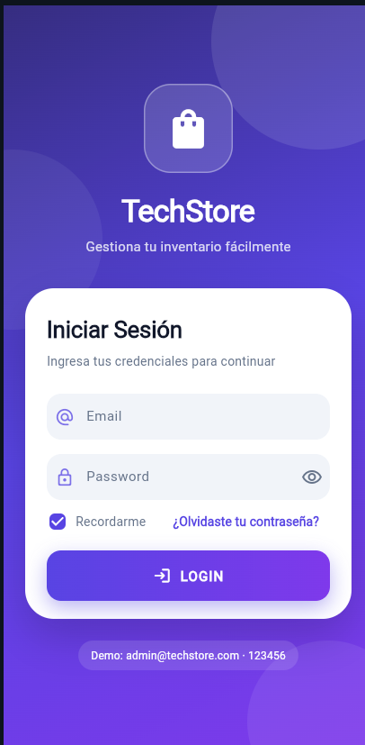
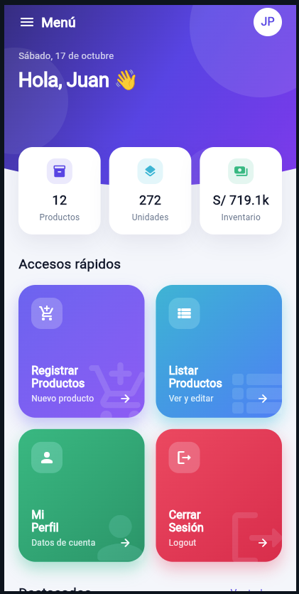
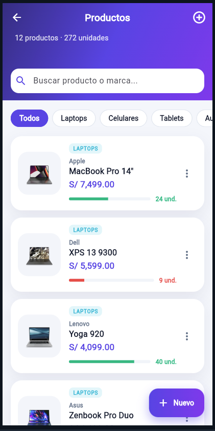
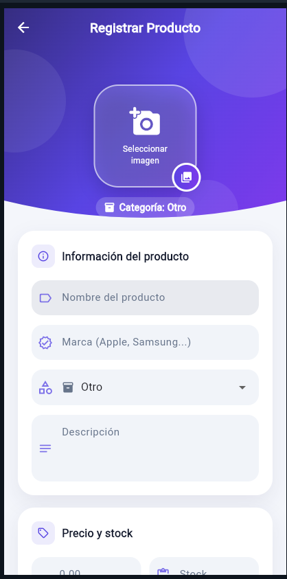
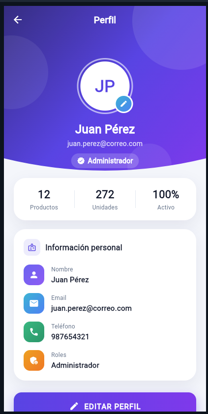

# TechStore App · Laboratorio Flutter (Sección B)

**Alumno:** Pablo Isla Arone · TECSUP, Diseño y Desarrollo de Software

App móvil hecha en Flutter con 5 pantallas conectadas: **Login → Menú → Listar productos → Registrar producto → Perfil**. Se respetó la estructura del mockup, pero con un diseño propio (degradados, tarjetas, animaciones) y todo funciona: los botones llevan a su pantalla, se pueden registrar, editar y eliminar productos, y editar el perfil.

Los productos son reales (MacBook Pro, Dell XPS 13, iPhone 13 Pro, Galaxy S10, iPad Mini, AirPods, Apple Watch, etc.) con fotos del catálogo público [DummyJSON](https://dummyjson.com) y precios referenciales en soles. Los datos se guardan en memoria mientras la app está abierta.

**Usuario de prueba:** `admin@techstore.com` / `123456`

## Capturas

| 1. Login | 2. Menú | 3. Listar productos | 4. Registrar producto | 5. Perfil |
|:---:|:---:|:---:|:---:|:---:|
|  |  |  |  |  |

Hay más capturas (filtro por categoría, vista previa, cerrar sesión, editar perfil) en la carpeta [`docs/capturas`](docs/capturas).

## Cómo ejecutarlo

### Opción 1: sin instalar nada (DartPad)
1. Entra a [dartpad.dev](https://dartpad.dev).
2. Copia todo el contenido de [`dartpad/main.dart`](dartpad/main.dart) (es el proyecto completo en un solo archivo) y pégalo en el editor.
3. Presiona **Run** y entra con el usuario de prueba.

### Opción 2: en VS Code con Flutter instalado
Necesitas Flutter 3.27 o superior y las extensiones **Flutter** y **Dart** en VS Code.

```bash
git clone https://github.com/pabloislaarone/lab_07-08_Multi.git
cd lab_07-08_Multi
flutter create . --project-name techstore_app   # genera android/, web/, windows/ sin tocar lib/
flutter pub get
flutter run -d chrome                            # o "flutter run" con un emulador abierto
```

En VS Code también puedes abrir la carpeta, elegir el dispositivo abajo a la derecha y presionar **F5**.

## Flujo de pantallas

```
LOGIN ──(credenciales correctas)──► MENÚ
                                     ├── Registrar Productos ──► REGISTRAR ──(Guardar)──► LISTAR
                                     ├── Listar Productos ─────► LISTAR ──(+ / Editar)──► REGISTRAR
                                     ├── Mi Perfil ────────────► PERFIL ──(Editar perfil)──► formulario
                                     └── Cerrar Sesión ─(confirmar)─► LOGIN
```

| Pantalla | Qué hace |
|---|---|
| Login | Valida el formato del email y que la contraseña tenga mínimo 6 caracteres; muestra error si los datos no coinciden. |
| Menú | Saludo con la fecha, resumen del inventario (productos, unidades, valor en S/), accesos en cuadrícula, carrusel de destacados y menú lateral. |
| Listar | Buscador por nombre o marca, filtro por categoría, barra de stock, editar o eliminar (deslizando, con opción de deshacer) y detalle al tocar. |
| Registrar | Foto desde una galería de productos reales o pegando una URL, marca, categoría, precio y stock con validación, y vista previa en vivo. Sirve también para editar. |
| Perfil | Datos del usuario, resumen de actividad, editar perfil (se actualiza también en el menú) y cerrar sesión. |

## Estructura del proyecto

```
lib/
├── main.dart                  # Arranca la app
├── routes/app_routes.dart     # Todas las rutas y las animaciones entre pantallas
├── theme/app_theme.dart       # Colores y estilos de toda la app
├── models/                    # Producto y Usuario
├── data/app_data.dart         # Productos, usuario y operaciones (agregar, editar, eliminar)
├── widgets/                   # Piezas reutilizables (botón, campo de texto, tarjeta, foto...)
└── screens/                   # Una pantalla por archivo
    ├── login_screen.dart
    ├── menu_screen.dart
    ├── listar_productos_screen.dart
    ├── registrar_producto_screen.dart
    └── perfil_screen.dart
dartpad/main.dart              # Todo el proyecto en un archivo para probar en DartPad
docs/capturas/                 # Capturas de la app funcionando
```

## Código que no vimos en clase

En el código están marcados con el comentario `// (No visto en clase)` y una explicación corta de qué hace cada parte.

| Concepto | Dónde | Para qué sirve |
|---|---|---|
| `onGenerateRoute` + `PageRouteBuilder` | `routes/app_routes.dart` | Navegación centralizada y transiciones propias (deslizar / desvanecer) |
| Argumentos entre rutas | `app_routes.dart`, `listar_productos_screen.dart` | La misma pantalla registra o edita según reciba un `Producto` |
| `ValueNotifier` + `ValueListenableBuilder` | `data/app_data.dart` | Estado compartido: al guardar un producto o editar el perfil, todas las pantallas se actualizan solas |
| `GlobalKey<FormState>` + `validator` | Login, Registrar, Perfil | Validar todos los campos con `validate()` |
| `RegExp` | Login, `producto.dart` | Validar email y formatear precios con comas (S/ 3,500.00) |
| `inputFormatters` | Registrar | Solo permite números en precio y stock |
| `mounted` / `context.mounted` | Login, Menú | Evitar usar el `context` después de un `await` si la pantalla se cerró |
| `pushNamedAndRemoveUntil` | Menú (logout), Registrar | Limpiar el historial de navegación |
| `showDialog<bool>` | Menú | Diálogo que devuelve la respuesta del usuario |
| `showModalBottomSheet` + `viewInsets` | Login, Listar, Registrar, Perfil | Hojas inferiores que suben con el teclado |
| `Dismissible` + `SnackBarAction` | Listar | Deslizar para eliminar con opción de deshacer |
| `Hero` | `producto_card.dart`, Listar | Animación del ícono de la lista al detalle |
| `AnimatedContainer` | Registrar | Animar el selector de imagen al elegir una |
| `Stack` + `Positioned` | Perfil | Avatar superpuesto sobre el encabezado |
| `copyWith` | Modelos | Editar objetos inmutables sin modificar el original |
| `CustomClipper<Path>` + `ClipPath` | `widgets/decorations.dart` | Encabezados con borde inferior curvo |
| `TweenAnimationBuilder` | `widgets/decorations.dart` (FadeSlideIn) | Animación de entrada en cascada sin AnimationController |
| `CustomScrollView` + `SliverAppBar` | Listar | Encabezado que se encoge al hacer scroll, con buscador fijo |
| `ChoiceChip` | Listar | Filtro por categoría |
| `LinearProgressIndicator` | `producto_card.dart` | Barra visual del stock |
| `ListenableBuilder` + `Listenable.merge` | Registrar | Vista previa que se actualiza mientras escribes |
| Botón con degradado (`DecoratedBox` + `InkWell`) | `primary_button.dart` | Botones con degradado y sombra de color |
| `FittedBox` | Menú, Listar | Ajustar textos largos sin overflow |
| `Image.network` + `loadingBuilder` / `errorBuilder` | `producto_imagen.dart` | Fotos desde internet con indicador de carga e ícono si falla |
| `ListView` horizontal | Menú (Destacados) | Carrusel de productos |
| `DropdownButtonFormField` | Registrar | Seleccionar categoría |
| `LayoutBuilder` | Registrar (galería) | Ajustar la foto al espacio disponible |
| `ColorScheme.fromSeed` (Material 3) | `theme/app_theme.dart` | Paleta completa a partir de un color |
